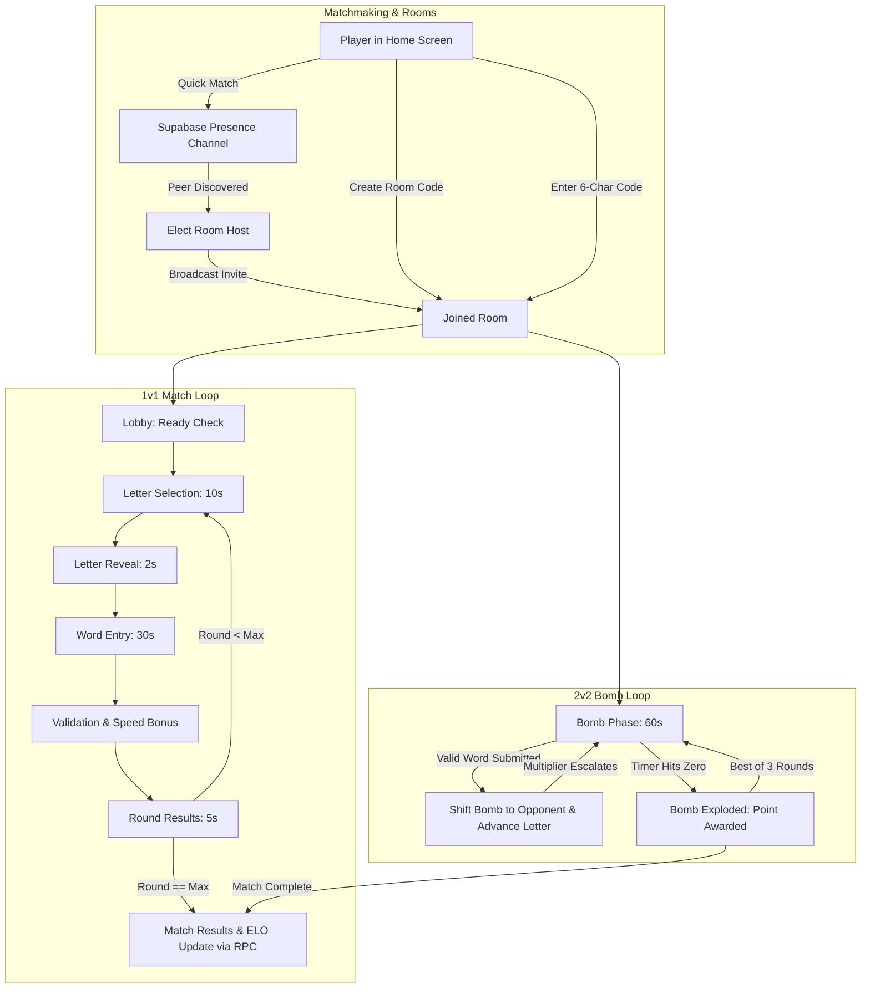

<p align="center">
  
</p>

<h1 align="center">⚡ WordRush</h1>

<p align="center">
  <strong>Fast-Paced, Real-Time Competitive Word Battle Across Web & Mobile</strong>
</p>

<p align="center">
  <a href="#features">Features</a> •
  <a href="#game-modes">Game Modes</a> •
  <a href="#architecture">Architecture</a> •
  <a href="#tech-stack">Tech Stack</a> •
  <a href="#getting-started">Getting Started</a> •
  <a href="#supabase-setup">Supabase Setup</a> •
  <a href="#mobile-builds">Mobile Builds</a>
</p>

<p align="center">
  
  
  
  
  
  
  
</p>

---

## 📖 Overview

**WordRush** is an adrenaline-fueled, multiplayer word dueling game built for players who think fast and type faster. Combining the tactical vocabulary depth of Scrabble with the high-pressure speed of blitz chess and party word games, WordRush pits wordsmiths against each other in real-time battles.

Every match tests your vocabulary under extreme pressure: lock in letters, formulate words matching dynamic boundary constraints, dodge ticking bomb detonations, and climb the global competitive ladder.

---

## ✨ Key Features

- **⚡ Real-Time Multiplayer Sync**: Zero-lag matchmaking and room state management powered by Supabase Realtime (Presence & Broadcast channels).
- **🔤 Dynamic "Sandwich" Letter Constraints**: Rounds require words beginning with one player's letter and ending with the opponent's letter, alternating turns to keep players on their toes.
- **💣 2v2 Hot Potato Bomb Mode**: Team-based panic mode! Chain words using the last letter of the previous word (*Shiritori* style). Longer words speed up the bomb's tick multiplier—pass it before it detonates!
- **🧠 Competitive ELO & Intelligence Points (IP)**: True skill tracking powered by a K-32 ELO rating formula, ensuring balanced matchmaking and high-stakes games.
- **🏆 Global Ranked Leaderboards**: Compete for top placement in the real-time Global Top 50 rankings.
- **🌫️ Fog-of-War Anti-Peeking**: Dynamic client-side masking conceals opponent letters and submitted words during live phases until reveal time.
- **🔊 Procedural Web Audio Engine**: Custom Web Audio API synthesizer for tactile mechanical key clicks, harmonic submission chimes, speed bonus fanfare, and thunderous bomb explosions.
- **💬 Real-Time Emotes & Social Reactions**: Floating animated emoji reactions with broadcasted physics.
- **🎨 Tactile Claymorphism Design**: Warm clay & terracotta color palette, responsive 3D tile press physics, Framer Motion animations, and confetti particle showers.
- **📱 True Cross-Platform (Web, iOS, Android)**: Native mobile runtime wrapped with Capacitor 8.

---

## 🎮 Game Modes

### 1. ⚔️ 1v1 Ranked Duels (Quick Match & Custom Rooms)
- **Letter Selection (10s)**: Both players choose an alphabet letter from a 3D tile grid.
- **Letter Sandwich Constraint**: In odd rounds, your word must start with Player 1's letter and end with Player 2's letter. In even rounds, the roles flip!
- **Word Entry (30s)**: Type a valid English dictionary word meeting the constraint. Live typing indicators notify opponents that you're active.
- **Scoring Breakdown**:
  - **Base Points**: 10 points
  - **Length Bonus**: +1 point per letter in the word
  - **Speed Demon Bonus**: **+5 points** to the fastest valid word submission
  - **Win Streak Multipliers**: Multipliers increase as you chain consecutive valid rounds
- **Outcome & ELO**: Matches run up to 10 rounds. Final scores adjust both players' **Intelligence Points (IP)** using an official ELO calculation.

### 2. 💣 2v2 Hot Potato Bomb Mode
- **4-Player Squad Battles**: Form teams of two and fight to keep the bomb out of your hands.
- **Word Chaining Rules**: The holding team must type a word that starts with the current letter (initially random).
- **Bomb Handoff**: When a team submits a valid word:
  1. The bomb passes instantly to the opposing team.
  2. The next required letter becomes the **last letter** of the word submitted.
  3. No word can be repeated during the round!
- **Tick Multiplier Escalation**: Submitting a word with 4+ letters increases the bomb's tick multiplier:
  $$\text{Multiplier} = \max(1, \text{length} - 3)$$
  Longer words force the bomb timer to drain 2x, 3x, or 4x faster on your opponents!
- **Detonation**: When the 60-second timer hits zero, **BOOM!** The opposing team gets a point. First team to 3 points wins.

---

## 🏗️ Architecture & State Machine

WordRush features an authoritative host-client hybrid model running over Supabase Realtime Channels:



### Real-Time Networking Channels
- **`global_lobby`**: Presence tracking channel for instantaneous peer matchmaking without requiring centralized match servers.
- **`room:{roomId}`**: Dedicated broadcast channel synchronizing timers, letter selections, word submissions, typing states, and live emotes.

---

## 💻 Tech Stack

| Layer | Technology | Description |
| :--- | :--- | :--- |
| **Framework** | [React 19](https://react.dev/) | Modern concurrent UI architecture |
| **Language** | [TypeScript](https://www.typescriptlang.org/) | Strict type safety across game state & protocol |
| **Build Tool** | [Vite 8](https://vite.dev/) | Lightning-fast HMR and optimized bundler |
| **Styling** | [Tailwind CSS v4](https://tailwindcss.com/) | Custom design system with modern CSS variables |
| **Animations** | [Framer Motion](https://www.framer.com/motion/) | Spring physics, tile clicks, modal transitions, and reactive UI |
| **Realtime / DB** | [Supabase](https://supabase.com/) | Realtime Broadcast, Presence, PostgreSQL, and secure RPC functions |
| **State Management**| [Zustand](https://github.com/pmndrs/zustand) | Lightweight, predictable reactive client store |
| **Mobile Runtime** | [Capacitor 8](https://capacitorjs.com/) | Native iOS & Android bridge |
| **Audio** | [Web Audio API](https://developer.mozilla.org/en-US/docs/Web/API/Web_Audio_API) | Zero-latency procedural sound synthesizer |
| **Dictionary** | [wordlist-english](https://www.npmjs.com/package/wordlist-english) | Scrabble-compatible English dictionary (300,000+ words) |
| **Icons & VFX** | [Lucide React](https://lucide.dev/) & [Canvas Confetti](https://www.npmjs.com/package/canvas-confetti) | Clean vector icons and victory celebration particles |

---

## 🎨 Design System

WordRush uses a custom **Claymorphism** visual theme engineered to feel tactile, physical, and friendly:

```css
--color-ink:         #221B2E;  /* Deep atmospheric backdrop */
--color-clay:        #2F2640;  /* Surface card clay */
--color-clay-light:  #3A2F4D;  /* Elevated tile surfaces */
--color-clay-dark:   #251E36;  /* 3D bevel bottom border */
--color-honey:       #F2A65A;  /* Primary radiant accent */
--color-terracotta:  #E8633D;  /* High-energy branding */
--color-moss:        #8FB996;  /* Success & valid validation */
--color-berry:       #C8506B;  /* Warning, low timer & explosions */
--color-cream:       #E9E2F2;  /* Smooth readable typography */
--color-muted:       #B7A8C9;  /* Secondary text */
```

---

## 📁 Repository Structure

```text
word-rush/
├── assets/                       # Branding logos and README graphics
│   └── word-rush-logo.png
├── frontend/                     # Core React + Vite application
│   ├── android/                  # Android native project (Capacitor)
│   ├── ios/                      # iOS native project (Capacitor)
│   ├── public/                   # Public assets & favicons
│   ├── src/
│   │   ├── components/           # UI components
│   │   │   ├── ui/               # LetterTile, TileButton, EmoteWheel, Modals
│   │   │   ├── BombPhase.tsx     # 2v2 Hot Potato interface
│   │   │   ├── LetterSelection.tsx
│   │   │   ├── WordEntry.tsx
│   │   │   └── ResultsPhase.tsx
│   │   ├── screens/              # Top-level screen views
│   │   │   ├── AuthScreen.tsx    # Supabase authentication
│   │   │   ├── HomeScreen.tsx    # Matchmaking & room lobby
│   │   │   ├── LobbyScreen.tsx   # Waiting room & room codes
│   │   │   └── GameScreen.tsx    # Active battle arena
│   │   ├── audio.ts              # Synthesizer Web Audio engine
│   │   ├── dictionary.ts         # Fast-lookup dictionary validator
│   │   ├── gameEngine.ts         # Authoritative game logic & ELO math
│   │   ├── realtime.ts           # Supabase Presence & Broadcast networking
│   │   ├── store.ts              # Zustand state store
│   │   ├── supabaseClient.ts     # Supabase client instantiation
│   │   └── types.ts              # Data contracts and TypeScript interfaces
│   ├── capacitor.config.ts       # Capacitor mobile configuration
│   ├── package.json
│   ├── tailwind.config.ts
│   └── vite.config.ts
└── README.md                     # Root project documentation
```

---

## 🚀 Getting Started

### Prerequisites
- **Node.js** (v18.0.0 or higher)
- **npm** or **pnpm**
- A free [Supabase](https://supabase.com) project

### Installation

1. **Clone the repository**:
   ```bash
   git clone https://github.com/itsgoksz/word-rush.git
   cd word-rush
   ```

2. **Navigate to the frontend and install dependencies**:
   ```bash
   cd frontend
   npm install
   ```

3. **Configure Environment Variables**:
   Copy the example environment configuration:
   ```bash
   cp .env.example .env
   ```
   Open `.env` and fill in your Supabase credentials:
   ```env
   VITE_SUPABASE_URL=https://your-project.supabase.co
   VITE_SUPABASE_ANON_KEY=your-supabase-anon-key
   ```

4. **Start the Development Server**:
   ```bash
   npm run dev
   ```
   Open [http://localhost:5173](http://localhost:5173) in your browser. Open an Incognito window to test real-time multiplayer between two players!

---

## 🗄️ Supabase Setup

WordRush relies on Supabase for player authentication, profiles, real-time presence/broadcast, and atomic match outcome transactions.

### 1. Enable Realtime
In your Supabase project dashboard:
1. Navigate to **Project Settings** > **API**.
2. Under **Realtime**, make sure Broadcast and Presence are enabled for your project.

### 2. Database Schema
Execute the following SQL in your Supabase SQL Editor:

```sql
-- Create the profiles table
CREATE TABLE IF NOT EXISTS public.profiles (
  id UUID REFERENCES auth.users(id) ON DELETE CASCADE PRIMARY KEY,
  username TEXT UNIQUE NOT NULL,
  elo INTEGER DEFAULT 1000 NOT NULL,
  wins INTEGER DEFAULT 0 NOT NULL,
  losses INTEGER DEFAULT 0 NOT NULL,
  created_at TIMESTAMP WITH TIME ZONE DEFAULT timezone('utc'::text, now()) NOT NULL
);

-- Enable Row Level Security (RLS)
ALTER TABLE public.profiles ENABLE ROW LEVEL SECURITY;

-- Allow public read access to leaderboard and player profiles
CREATE POLICY "Profiles are viewable by everyone" 
  ON public.profiles FOR SELECT 
  USING (true);

-- Allow authenticated users to insert their own profile
CREATE POLICY "Users can insert their own profile" 
  ON public.profiles FOR INSERT 
  WITH CHECK (auth.uid() = id);

-- Allow authenticated users to update their own profile
CREATE POLICY "Users can update their own profile" 
  ON public.profiles FOR UPDATE 
  USING (auth.uid() = id);

-- Stored Procedure: Update Match Result (Atomic ELO Update)
CREATE OR REPLACE FUNCTION public.update_match_result(
  winner_id UUID,
  loser_id UUID,
  winner_elo_change INTEGER,
  loser_elo_change INTEGER
)
RETURNS VOID AS $$
BEGIN
  -- Update Winner
  UPDATE public.profiles
  SET 
    elo = elo + winner_elo_change,
    wins = wins + 1
  WHERE id = winner_id;

  -- Update Loser
  UPDATE public.profiles
  SET 
    elo = GREATEST(100, elo + loser_elo_change),
    losses = losses + 1
  WHERE id = loser_id;
END;
$$ LANGUAGE plpgsql SECURITY DEFINER;
```

---

## 📱 Mobile Builds (Capacitor)

WordRush is configured to build natively for iOS and Android using Capacitor:

### 1. Build the Web Assets and Sync
```bash
cd frontend
npm run sync
```

### 2. Run on iOS (macOS required with Xcode)
```bash
npx cap open ios
```
*Select your target simulator or plugged-in iPhone in Xcode and click **Run**.*

### 3. Run on Android (Android Studio required)
```bash
npx cap open android
```
*Build the APK or run directly to an Android Virtual Device (AVD).*

---

## 🤝 Contributing

Contributions make the open-source community an amazing place to learn, inspire, and create. Any contributions you make are **greatly appreciated**!

1. Fork the Project
2. Create your Feature Branch (`git checkout -b feature/AmazingFeature`)
3. Commit your Changes (`git commit -m 'Add some AmazingFeature'`)
4. Push to the Branch (`git push origin feature/AmazingFeature`)
5. Open a Pull Request

---

## 📄 License

Distributed under the **MIT License**. See `LICENSE` for more information.

---

<p align="center">
  Crafted with ❤️ by <a href="https://github.com/itsgoksz">itsgoksz</a>
</p>
