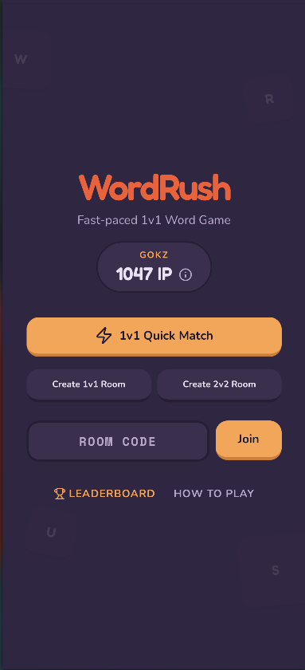
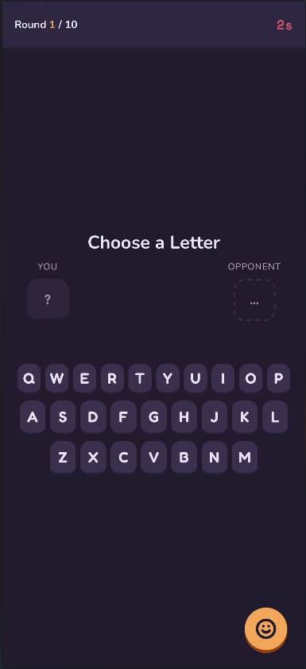
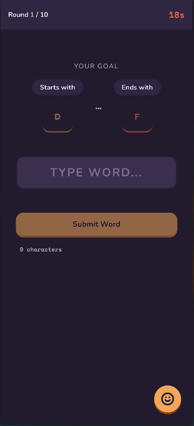
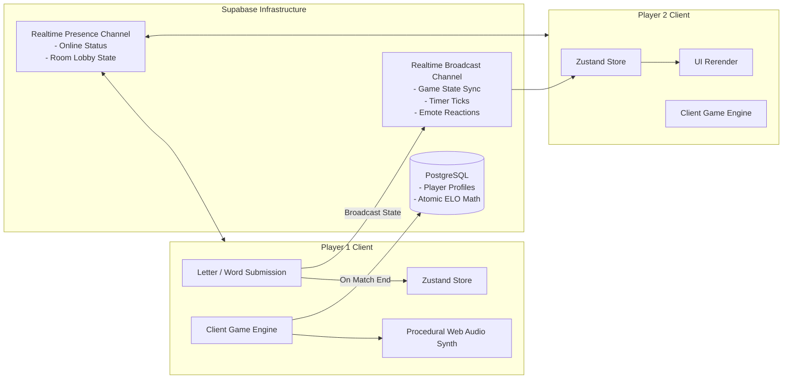

<p align="center">
  
</p>

# WordRush

> Fast-paced, real-time competitive word dueling on web and mobile. Scrabble tactics collide with high-pressure blitz chess. Lock boundary letters, dodge ticking bomb fuses, and climb the global ELO ladder.

<p align="center">
  
</p>

---

## The Big Idea

Word games have been stuck in slow, asynchronous loops for decades: waiting 4 hours for an opponent to play a 3-letter word on a board. 

**WordRush** was built for people who crave high-adrenaline, real-time vocabulary battles:
- **1v1 Quick Match & Competitive Ladder:** Jump into instant matchmaking or challenge friends across custom 1v1 and 2v2 rooms with room codes, live rating tracking (IP / Elo system), and global leaderboards.
- **1v1 Blitz (Sandwich Constraints):** You pick a starting letter, your opponent picks an ending letter. Both players scramble against a ticking fuse to type valid dictionary words that satisfy the boundary letters. Speed and word length grant massive multipliers!
- **2v2 Hot Potato Bomb Mode:** Team panic mode! Words chain off the last letter of the opponent's word (*Shiritori* style). Every successful pass accelerates the bomb's tick multiplier. Don't let the fuse detonate while the bomb is in your hands!
- **Zero-Server Peer Sync:** Runs entirely over **Supabase Realtime Broadcast & Presence channels**. No separate game server process to keep alive—the client game engine authoritatively validates turns, ticks timers, and broadcasts state across rooms with sub-50ms latency.
- **Synthesized Web Audio:** Every sound—the mechanical key presses, countdown sirens, harmonic chord submissions, and bomb explosions—is generated procedurally in real time via the **Web Audio API**. Zero bulky MP3 files to download.
- **Tactile Claymorphic Design:** Custom clay-themed UI built with Tailwind CSS v4 and Framer Motion spring physics. Tiles compress, bounce, and react to every tap.

---

## Game Modes & Battle Rules

### 1. 1v1 Blitz Mode

| Letter Draft & Selection Phase | Real-Time Word Battle Arena |
| :---: | :---: |
|  |  |
| **Tactical Letter Drafting:** Real-time round countdown (Round 1/10) where players lock in starting or ending boundary letters via the claymorphic keyboard. | **Constraint-Driven Speed Duel:** 18-second fuse requiring words satisfying sandwich constraints (e.g. Starts with D, Ends with F) with live character validation. |

1. **Letter Selection (10s):** One player locks in the first letter; the opponent locks in the last letter.
2. **The Reveal (2s):** Both boundary letters slam into the board.
3. **Word Entry (30s):** Type and submit words that begin and end with the designated sandwich letters. Validated instantly against a 300,000+ word offline dictionary.
4. **Scoring:** Points scale with word length multiplied by submission speed.
5. **Match Resolution:** Battle across up to 10 rounds. The winner takes the match and claims ELO rating points.

### 2. 2v2 Hot Potato Bomb Mode
- 4 players divided into 2 teams.
- Words must begin with the ending letter of the previous team's submission.
- The bomb clock constantly ticks down. Submitting a word hands the active bomb to the next opponent.
- If the bomb detonates while you're holding it, your team loses the round.

---

## Architecture & Peer-to-Peer Networking

WordRush achieves sub-50ms turn synchronization without running an authoritative game server like Colyseus or Node sockets:



- **Room Host Election:** The first player in a lobby acts as the authoritative room clock coordinator, broadcasting timestamp ticks across the channel.
- **Anti-Peeking Client Masking:** Opponent inputs and draft letters remain masked on the client until submission reveal.
- **Offline Validation:** Words are checked synchronously against `wordlist-english` on the client, eliminating API latency during fast typing.

---

## Tech Stack

| Layer | Technology | Details |
| :--- | :--- | :--- |
| **Framework** | [React 19](https://react.dev/) + [Vite 8](https://vite.dev/) | Ultra-fast HMR and optimized bundler |
| **Language** | [TypeScript](https://www.typescriptlang.org/) | Strict type contracts across engine & networking |
| **Networking** | [Supabase Realtime](https://supabase.com/) | Realtime Presence & Broadcast channels |
| **State** | [Zustand](https://github.com/pmndrs/zustand) | Lightweight, predictable client state store |
| **Styling** | [Tailwind CSS v4](https://tailwindcss.com/) | Custom tactile claymorphism color palette |
| **Animations** | [Framer Motion](https://www.framer.com/motion/) | Spring-based tile physics & modal transitions |
| **Procedural Audio** | Web Audio API | Low-latency oscillator-based sound synthesizer |
| **Mobile Runtime** | [Capacitor 8](https://capacitorjs.com/) | Cross-platform builds for iOS & Android |

---

## Repository Structure

```text
word-rush/
├── assets/                       # Branding logos & gameplay screenshots
│   ├── word-rush-logo.png        # App icon badge
│   ├── preview.png               # Main lobby & matchmaking interface
│   ├── draft_preview.png         # Tactical letter selection phase
│   └── battle_preview.png        # Live word duel & constraint board
├── frontend/                     # Core React + Vite client
│   ├── src/
│   │   ├── components/           # UI components
│   │   │   ├── ui/               # LetterTile, TileButton, EmoteWheel, FloatingEmotes
│   │   │   ├── LetterSelection.tsx # 1v1 letter draft stage
│   │   │   ├── WordEntry.tsx     # Active word input board
│   │   │   ├── BombPhase.tsx     # 2v2 Hot Potato bomb interface
│   │   │   └── ResultsPhase.tsx  # Round tally & match victory screen
│   │   ├── screens/
│   │   │   ├── AuthScreen.tsx    # Supabase authentication
│   │   │   ├── HomeScreen.tsx    # Quick match & custom room lobby
│   │   │   ├── LobbyScreen.tsx   # Waiting room & room codes
│   │   │   └── GameScreen.tsx    # Active battle arena
│   │   ├── audio.ts              # Web Audio procedural sound engine
│   │   ├── dictionary.ts         # Fast 300k+ word lookup engine
│   │   ├── gameEngine.ts         # Authoritative turn loop & timing
│   │   ├── realtime.ts           # Supabase Presence & Broadcast channels
│   │   ├── store.ts              # Zustand global game state
│   │   └── supabaseClient.ts     # Supabase client initialization
│   ├── android/                  # Capacitor Android project
│   ├── ios/                      # Capacitor iOS project
│   ├── package.json
│   ├── vite.config.ts
│   └── capacitor.config.ts
└── README.md
```

---

## Getting Started

### 1. Clone & Install
```bash
git clone https://github.com/itsgoksz/word-rush.git
cd word-rush/frontend
npm install
```

### 2. Configure Environment Variables
Create a `.env` file inside `frontend/`:
```env
VITE_SUPABASE_URL=https://your-project.supabase.co
VITE_SUPABASE_ANON_KEY=your-supabase-anon-key
```

### 3. Supabase Realtime & Database Setup
In your Supabase project:
1. Ensure **Realtime** is enabled under **Project Settings > API**.
2. Run this schema in the Supabase SQL Editor for player profiles and atomic ELO scoring:

```sql
CREATE TABLE IF NOT EXISTS public.profiles (
  id UUID REFERENCES auth.users(id) ON DELETE CASCADE PRIMARY KEY,
  username TEXT UNIQUE NOT NULL,
  elo INTEGER DEFAULT 1000 NOT NULL,
  wins INTEGER DEFAULT 0 NOT NULL,
  losses INTEGER DEFAULT 0 NOT NULL,
  created_at TIMESTAMP WITH TIME ZONE DEFAULT timezone('utc'::text, now()) NOT NULL
);

ALTER TABLE public.profiles ENABLE ROW LEVEL SECURITY;

CREATE POLICY "Profiles are viewable by everyone" ON public.profiles FOR SELECT USING (true);
CREATE POLICY "Users can insert their own profile" ON public.profiles FOR INSERT WITH CHECK (auth.uid() = id);
CREATE POLICY "Users can update their own profile" ON public.profiles FOR UPDATE USING (auth.uid() = id);

-- Atomic Match ELO calculation
CREATE OR REPLACE FUNCTION public.update_match_result(
  winner_id UUID,
  loser_id UUID,
  winner_elo_change INTEGER,
  loser_elo_change INTEGER
)
RETURNS VOID AS $$
BEGIN
  UPDATE public.profiles SET elo = elo + winner_elo_change, wins = wins + 1 WHERE id = winner_id;
  UPDATE public.profiles SET elo = GREATEST(100, elo + loser_elo_change), losses = losses + 1 WHERE id = loser_id;
END;
$$ LANGUAGE plpgsql SECURITY DEFINER;
```

### 4. Start the Dev Server
```bash
npm run dev
```
Open [http://localhost:5173](http://localhost:5173) in two browser windows to test real-time 1v1 matchmaking locally.

---

## Mobile Builds (iOS & Android)

```bash
cd frontend
npm run build
npx cap sync

# Open in Xcode or Android Studio
npx cap open ios
npx cap open android
```

---

<p align="center">
  Crafted by <a href="https://github.com/itsgoksz">itsgoksz</a>
</p>
